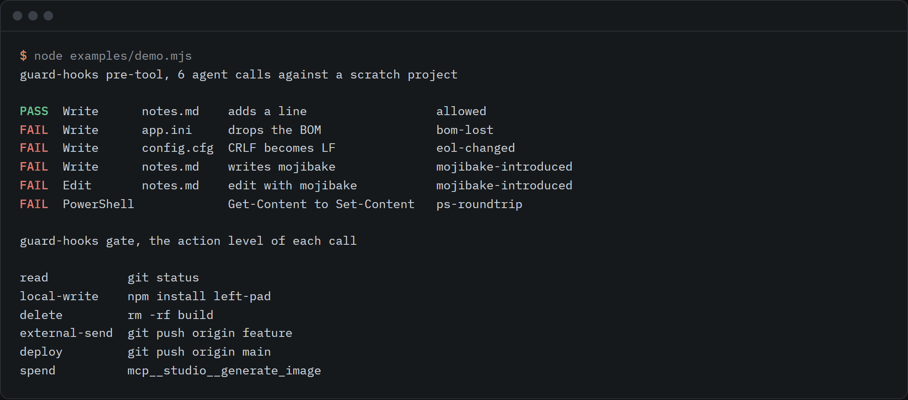

# guard-hooks

Hooks that block an agent write that would damage a file (lost BOM, mojibake, changed line endings) and classify an action's risk level.



```sh
npx github:rishsadh/guard-hooks init
```

`init` prints the settings snippet for Claude Code. It writes nothing. Merge it into `.claude/settings.json`. Zero dependencies, Node 18 or newer.

## Why this exists

Coding agents rewrite whole files, and some of them lose things that are not visible in a diff.

- 2026-02-11: a Cursor forum thread reports that agent edits strip the UTF-8 BOM and fail a build that needs it ([thread](https://forum.cursor.com/t/agent-edits-strip-utf-8-bom-encoding-corrupting-builds/151517)).
- 2026-02-24: Claude Code issue 28316 reports that the Write tool saves UTF-8 without a BOM, and that Delphi and SQL Server Management Studio then show "¿Cómo estás?" for "¿Cómo estás?". It was closed as a duplicate ([issue](https://github.com/anthropics/claude-code/issues/28316)).
- Agents on Windows often edit through PowerShell. On 2026-09-30, in Windows PowerShell 5.1, `(Get-Content f) | Set-Content f` on a UTF-8 file with a BOM wrote back the bytes `63 61 66 E9 20 3F` for "café 你": the BOM gone, the é a single invalid byte, the Han character a question mark. The script that shows this is `examples/ps51-roundtrip.ps1`.
- It also happened in the maintainer's own repo: a bulk find and replace through `Get-Content -Raw` and `WriteAllText` turned arrows, dashes and bullets on six pages into mojibake, and the damage reached a live page.

The fix is cheap if it runs before the write lands. guard-hooks compares the file on disk with what the agent is about to write, and refuses when the change loses a BOM, flips line endings, or introduces mojibake, replacement characters or NUL bytes. The refusal goes back to the agent as text, so it can correct itself.

The same package carries a small classifier for what a tool call does: read, local write, delete, external send, deploy or spend. A hook can ask or deny by level. It is a vocabulary plus a classifier, not a sandbox.

## Use it

### Install the hooks

```sh
npm install -g github:rishsadh/guard-hooks   # so the hooks start fast
guard-hooks init            # encoding guard
guard-hooks init --gate     # plus the action-level gate
```

The snippet looks like this (with `--gate` there is one more `PreToolUse` entry):

```json
{
  "hooks": {
    "PreToolUse": [
      { "matcher": "Write|Edit|MultiEdit|Bash|PowerShell",
        "hooks": [{ "type": "command", "command": "guard-hooks pre-tool" }] }
    ],
    "PostToolUse": [
      { "matcher": "Write|Edit|MultiEdit",
        "hooks": [{ "type": "command", "command": "guard-hooks post-tool --fix" }] }
    ]
  }
}
```

Run from a clone, `init` uses `node` with the absolute path instead, which starts faster than `npx` on every tool call.

### What the hooks do

| Hook | When | What |
|---|---|---|
| `pre-tool` | before Write, Edit, MultiEdit, Bash, PowerShell | Write: compares the whole new content with the file on disk and exits 2 on damage. Edit and MultiEdit: checks the replacement text and saves a fingerprint. Shell: lints the command for encoding hazards. |
| `post-tool [--fix]` | after Write, Edit, MultiEdit | Compares the real file with the fingerprint. `--fix` restores a lost or added BOM and a flipped line-ending style. It never repairs mojibake. |
| `gate [--ask a,b] [--deny a,b]` | before any tool | Classifies the call and asks or denies by level. Silent for `read` and `local-write`. |

Exit code 2 blocks the tool call and shows the reason to the agent. Bad input never blocks: a hook that cannot read its input lets the call through and says so on stderr.

What a blocked write looks like to the agent:

```
guard-hooks blocked this Write to app.ini:
- bom-lost: the file started with a UTF-8 BOM and the result does not. Tools that need the BOM will read the file as ANSI. Keep the EF BB BF bytes at the start.
Fix the content and try again. If this change is intended, the user can allow it for this path in .guard-hooks.json ("allow").
```

### Commands you can run yourself

```sh
guard-hooks check src/*.ps1                  # mojibake, replacement characters, NUL, mixed endings
guard-hooks compare before.txt after.txt     # what this change would damage
guard-hooks staged                           # staged changes against HEAD, for a pre-commit hook
guard-hooks classify "git push origin main"  # the action level of a command
guard-hooks levels                           # the ladder
```

`check`, `compare` and `staged` exit 1 when they find damage. `--json` gives machine output. `examples/pre-commit` is a ready git hook that runs `staged`, so the check also covers agents that have no hooks.

### What it checks

Every finding is about bytes, and counts only when a change makes things worse: a file that already had mojibake is not blamed for it. The full list, how mojibake is recognised, and the measurements and sources are in [docs/ENCODING.md](docs/ENCODING.md).

| Finding | Example |
|---|---|
| `bom-lost`, `bom-added` | A UTF-8 BOM disappears, or appears on a file that never had one. |
| `eol-changed`, `eol-mixed` | A CRLF file comes back with LF, or with a few LF lines mixed in. |
| `mojibake-introduced` | "Gestión" arrives as "Gestión". The message names the repair. |
| `replacement-char-introduced`, `lossy-question-marks` | Text was lost on the way in. |
| `legacy-encoding-rewritten`, `encoding-changed`, `invalid-utf8` | A Latin-1 or UTF-16 file would be rewritten as UTF-8. |
| `bom-required` | A new `.pas` or `.sql` file with accents and no BOM, where the project says it needs one. |

### The action ladder

```sh
guard-hooks classify "rm -rf build && git push origin main"
```

| Level | Meaning |
|---|---|
| `read` | Changes nothing. |
| `local-write` | Changes files on this machine, in a way git can undo. |
| `delete` | Destroys data, or discards work that has no copy. |
| `external-send` | Sends data to, or changes state on, another system. |
| `deploy` | Publishes or releases something others will run or read. |
| `spend` | Uses money or metered credit. |

A call carries every level it touches, plus flags such as `remote-code` or `rewrites-remote-history`. The ladder says what an action is. What to do about a level is a policy: the default asks for everything above `local-write` and denies nothing. The spec, the flags, and how shell, PowerShell and MCP tool names are read are in [docs/LEVELS.md](docs/LEVELS.md). The ladder is also published as [docs/levels.json](docs/levels.json), and the functions are importable:

```js
import { classifyTool, decide } from 'guard-hooks';
```

### Configuration

An optional `.guard-hooks.json` in the project root (or any parent) tunes it. See `examples/guard-hooks.example.json`.

```json
{
  "ignore": ["vendor/**"],
  "allow": [{ "glob": "**/*.bat", "codes": ["eol-changed"] }],
  "requireBom": ["**/*.pas", "**/*.sql"],
  "powershell": "5.1",
  "gate": { "ask": ["delete", "deploy"], "deny": ["spend"], "rules": [{ "tool": "^mcp__studio__render", "level": "spend" }] }
}
```

## What it does not do

- **It cannot see inside a shell command.** The lint reads the command text. A script that rewrites files, or a command that builds its arguments at run time, gets through. `staged` and `post-tool` are the backstop.
- **For Edit and MultiEdit it can only judge the replacement text.** The editor does its own reading and writing, so a lost BOM or flipped line ending shows up in `post-tool`, after the fact. With `--fix` it is repaired on the spot. Without it the agent is told.
- **Only Claude Code hooks are wired up.** The input format is the one documented at code.claude.com/docs/en/hooks, read on 2026-09-30. It has been tested against that format and not yet against a long live session. Other agents can use `check`, `compare`, `staged` and the library.
- **It does not know what an editor does with a leading BOM character.** `pre-tool` asks the agent to keep the BOM and `post-tool` checks the result. If an agent's writer always strips it, `--fix` is the way through.
- **Mojibake detection is for Latin-1 and Windows-1252 reads of UTF-8.** GBK, Shift-JIS and double-encoded text are not handled. Text that talks about mojibake will trip it, so list those files under `ignore`.
- **The classifier is a safety net, not a sandbox.** It reads names and arguments. Unknown commands are assumed to write and are flagged `unclassified`. The lists of deploy commands and paid API hosts are short and hand-written.
- **The ladder order is a judgement.** A send can be as hard to undo as a delete. Policies name levels, so you can order your own rules.
- **It is not a repair tool.** `text-encoding-guard` repairs Chinese mojibake after the fact, and `mcp-fileencoding` handles GBK files through its own MCP tools. This one blocks a write before it lands and covers BOMs, line endings and Latin-1 or Windows-1252 damage. Facts about both were read on 2026-09-30.

## Tests

```sh
npm test
```

94 tests, using only `node:test`. The fixtures that contain mojibake are produced by code from real text, not typed by hand.

## Licence

MIT. By [@rishsadh](https://github.com/rishsadh).
